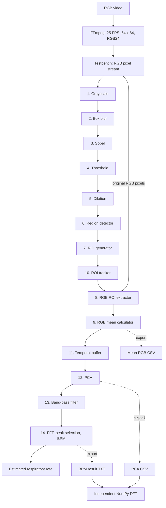

# Contactless Respiratory Rate Estimation: 14-Stage VHDL Pipeline

VHDL-2008 pipeline that estimates respiratory rate (breaths per minute) from colour variations of a face region in an RGB video (rPPG). The chain combines image preprocessing, ROI extraction, temporal RGB analysis, PCA, band-pass filtering and a 512-point FFT. It is verified in simulation with a VHDL testbench in ModelSim and cross-checked with an independent Python/NumPy analysis.

> **Status:** simulation validated on one test video (15 BPM). Deployment on the DE10-Standard board is **in progress and not yet validated**.

## Features

- RGB24 video stimulus for the testbench, prepared with FFmpeg and PowerShell.
- Spatial preprocessing: grayscale, box blur, Sobel, threshold, 3 × 3 dilation.
- ROI localization and tracking, RGB pixel selection and per-frame RGB means.
- 512-sample temporal window, fixed-point PCA.
- Recursive high-pass/low-pass filter, 512-point FFT, spectral peak selection and BPM conversion.
- Testbench checks for data validity, PCA completion, processing completion and input overflow.
- TEXTIO export of intermediate images and numeric results.
- Independent NumPy DFT and plots to interpret the simulation.

## Tools

| Component | Technology |
| --- | --- |
| Hardware description | VHDL-2008 (`vcom -2008`) |
| Simulation | ModelSim Intel FPGA Starter Edition 10.5b |
| Target board | DE10-Standard (Cyclone V), integration in progress |
| Video preparation | FFmpeg (RGB24), Windows PowerShell |
| Numerical check | Python, NumPy, Matplotlib |
| Environment | Windows 11 |

## Architecture

The diagram shows the functional processing flow. The edge-processing path only locates the ROI; the colour measurements are taken from the original RGB pixels, not from the Sobel image.



The 14 stages are a functional grouping. FFT and BPM calculation are in separate VHDL files, and top-level entities connect the stages.

For an FFT of length `N = 512` at `Fs = 25` Hz, spectral index `k` corresponds to:

$$
\mathrm{BPM} = \frac{60\,k\,F_s}{N}
$$

For `k = 5` this gives about **14.65 BPM**, output as **15 BPM** after integer rounding.

## Results

Values recorded for one input sequence in simulation. They do not establish clinical accuracy or real-time FPGA performance.

| Metric | Value | Note |
| --- | ---: | --- |
| Input sequence | 515 RGB frames | 64 × 64 pixels, 25 FPS, 20.6 s |
| RAW RGB24 file | 6,328,320 bytes | |
| Hex text stimulus | 16,875,520 bytes | One `RRGGBB` line per pixel |
| RGB means produced | 515 | |
| PCA samples | 512 | |
| FFT window | 20.48 s | 512 / 25 |
| Bin resolution | 0.0488 Hz | About 2.93 BPM per bin |
| Selected spectral bin | 5 | |
| Estimated rate | 15 BPM | About 14.65 BPM before rounding |
| Input overflow | 0 | |
| Flags | `PCA_last=1`, `BPM_valid=1`, `done=1` | |
| Independent DFT | Bin 5 in the 6–30 BPM band | Same bin as the VHDL result |
| Simulated interval | 55 ms | Simulated circuit time, not latency |

The NumPy check confirms the dominant spectral bin. It does not prove sample-by-sample equality with the RTL: the Python plots use an ideal frequency mask, while the RTL uses a recursive fixed-point filter.

## Validation procedure

1. Convert the input video to 515 RGB24 frames (64 × 64, 25 FPS) and check the RAW and text file sizes.
2. Compile and simulate with `run_models.do`.
3. Inspect the waveforms: `rgb_in`, `valid_in`, `frame_start`, then the RGB means, the PCA counters and flags, and the FFT/BPM outputs.
4. Check the transcript: 515 RGB means, 512 PCA samples, bin 5, 15 BPM, no overflow.
5. Review the exported images and ROI positions (frames 0, 128, 257, 386 and 514).
6. Run the NumPy DFT on the exported PCA samples and verify that the dominant bin in the respiratory band is 5.
7. Check that exported files are non-empty and carry the timestamp of the latest run.

**Not validated yet:** real-time processing on hardware, a live PC-to-FPGA video interface, several subjects or motion conditions, and accuracy against a reference respiration sensor.

## Repository structure

```text
.
├── README.md
├── run_models.do
├── 01_CONVERTIR_RP.ps1
├── 03_CREER_IMAGES.ps1
├── VHDL/
│   ├── Grayscale_Pipeline.vhd
│   ├── Box_Blur_Pipeline.vhd
│   ├── Sobel_Pipeline.vhd
│   ├── Threshold_Pipeline.vhd
│   ├── Morphology_Pipeline.vhd
│   ├── Region_detector.vhd
│   ├── roi_generator.vhd
│   ├── rgb_roi_extractor.vhd
│   ├── rgb_mean_calculator.vhd
│   ├── skin_roi_tracker.vhd
│   ├── rgb_temporal_buffer.vhd
│   ├── pca_rgb.vhd
│   ├── bandpass_filter.vhd
│   ├── fft_512.vhd
│   ├── bpm_calculator.vhd
│   ├── respiratory_pipeline_14blocks.vhd
│   ├── respiratory_processing_12to14.vhd
│   └── tb_video_reelle_14blocks_export.vhd
├── scripts/
│   └── validate_spectrum.py
└── docs/images/
```

The test video and all files derived from it (RAW, TXT, images, CSV) are not included.

## How to reproduce

**Requirements:** Windows 11, ModelSim Intel FPGA Starter Edition 10.5b, FFmpeg in `PATH`, PowerShell, Python with NumPy and Matplotlib.

**1. Provide a test video.** Put a short front-facing face video (about 21 s) that you have the right to use in the project folder as `rp.mp4`.

**2. Convert it.** `01_CONVERTIR_RP.ps1` runs FFmpeg and writes one `RRGGBB` line per pixel for the testbench:

```powershell
powershell -NoProfile -ExecutionPolicy Bypass -File .\01_CONVERTIR_RP.ps1
```

The FFmpeg step of the script is:

```powershell
ffmpeg -hide_banner -loglevel error -y -i rp.mp4 `
  -vf "fps=25,scale=64:64:flags=bicubic" `
  -frames:v 515 -f rawvideo -pix_fmt rgb24 `
  video_rgb_515frames.raw
```

**3. Simulate.** In the ModelSim transcript, from the repository root:

```tcl
cd {path/to/repository}
do run_models.do
```

The script compiles the sources with `vcom -2008`, loads the testbench and runs 55 ms. For the original test video, the transcript ends with:

```text
BILAN moyennes=515, PCA=512, PCA_last=1, overflow=0, BPM_valid=1, done=1
RESULTAT : pic spectral detecte, BPM=15, indice=5
```

Other videos will give other values.

**4. Images and exports.** Check that `10_mean_rgb.csv`, `11_pca_samples.csv` and `13_bpm_result.txt` are non-empty, then rebuild the PNG images:

```powershell
powershell -NoProfile -ExecutionPolicy Bypass -File .\03_CREER_IMAGES.ps1
```

**5. Independent check.**

```powershell
python -m pip install numpy matplotlib
python .\scripts\validate_spectrum.py
```

The script reads the three exported files, computes the NumPy DFT, saves seven figures and compares the dominant bin in the 6–30 BPM band with the VHDL result.

## Possible improvements

- Integrate the design on the DE10-Standard and measure resources, clock rate and throughput.
- Validate a continuous live-video path with buffering and flow control.
- Compare the estimated rate with a reference respiration measurement on several recordings.
- Evaluate ROI tracking with motion and lighting changes.
- Add module-level tests and numerical fixed-point checks.

## Author

**Hamza Daanoun**, final-year engineering student in embedded systems, ENSA Agadir
GitHub: https://github.com/hamzadaanoun
LinkedIn: [TO COMPLETE]
